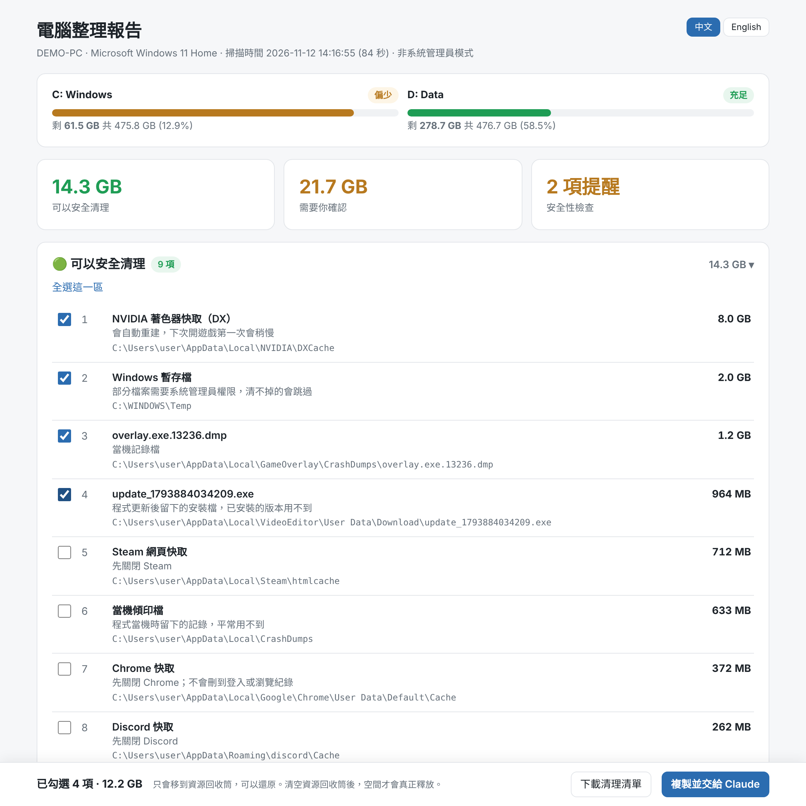
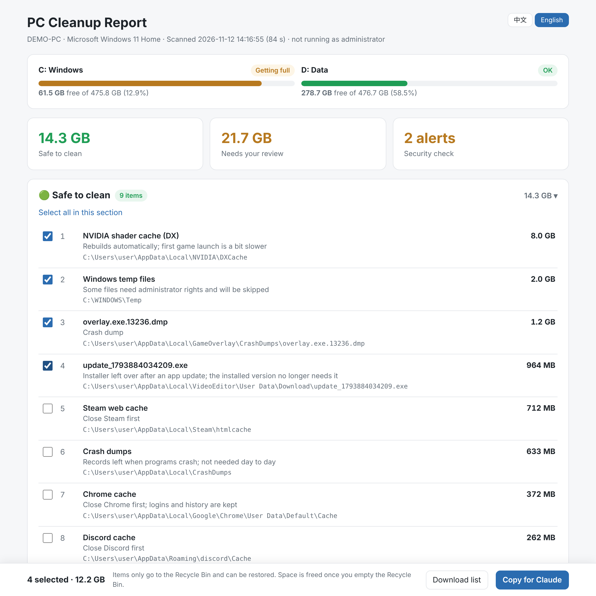

# Windows PC Cleanup — Claude Skill

**繁體中文** | [English](#english)

一個讓 Claude 幫你**安全地**整理 Windows 電腦的 skill：找出暫存檔、快取、舊版本殘留和大型檔案，檢查開機程式與安全性，並產生一份**可以勾選的視覺化報告**。

> **核心原則：先看、說清楚、沒經過你同意什麼都不動，而且每一步都能還原。**



[查看範例報告（使用假資料）](docs/sample-report.html)

## 特色

- **視覺化報告**：雙擊就能掃描，掃完自動用瀏覽器打開報告，包含磁碟使用量、🟢 可安全清理／🟡 需確認／⚪ 不要動的分級清單、最大資料夾長條圖、程式建議、開機項目和安全性檢查
- **自選掃描範圍**：掃描時跳出 Windows 資料夾選擇視窗，可以把 D 槽或任何資料夾加進來
- **偵測舊版本殘留**：自動找出同一個程式留下好幾個版本資料夾的情況，並保留最新版本
- **刪除或搬家**：大型影片可以選擇「搬到空間比較多的磁碟」，不一定要刪
- **安全性檢查**：Windows Defender 狀態、可疑的開機項目、暫存資料夾裡的執行檔、Minecraft 惡意模組（fractureiser）跡象
- **絕不永久刪除**：只會移到資源回收筒；會拒絕處理系統資料夾和程式安裝資料夾，並先試跑一次讓你確認
- **中英雙語**：報告會依照 Windows 語言自動切換，右上角也可以手動切換；Claude 會用使用者的語言對話
- **報告本身不會刪任何東西**：沒有刪除按鈕，也不會開本機伺服器。勾選結果交給 Claude，由你確認後才執行

## 安裝

### 方法一：上傳 skill（Claude 桌面版／claude.ai）

1. 到 [Releases](../../releases) 下載 `windows-pc-cleanup.skill`，或使用本 repo 的 `dist/windows-pc-cleanup.skill`
2. 在 Claude 打開「設定 → 功能（Capabilities）→ Skills」，上傳這個檔案
3. 對 Claude 說「幫我整理電腦」就會啟動

### 方法二：Claude Code

```bash
git clone https://github.com/Brian2514bx/windows-pc-cleanup.git
cp -r windows-pc-cleanup/windows-pc-cleanup ~/.claude/skills/
```

## 使用流程

1. **掃描**：雙擊 `Start-Scan.bat`（Claude 會告訴你檔案在哪裡）。可以選擇要額外掃描的磁碟，掃描期間不會改動任何東西
2. **勾選**：報告自動打開。勾選要處理的項目，按「複製並交給 Claude」
3. **貼回對話**：Claude 會整理清理清單，放進 `pc-scan` 資料夾
4. **清理**：雙擊 `run_cleanup.bat`，先確認試跑結果，按任意鍵後才會移到資源回收筒
5. **清空資源回收筒**：由你自己確認後再清空，空間才會真正釋放

不想用報告也可以直接在對話裡回覆編號，例如「清 1、3、5」。

## 檔案結構

```
windows-pc-cleanup/            ← skill 本體（上傳或複製這個資料夾）
├── SKILL.md                   ← 給 Claude 的操作說明
├── scripts/
│   ├── Start-Scan.bat         ← 雙擊開始掃描
│   ├── scan.ps1               ← 唯讀掃描，產生 report.json / report.html
│   ├── report_template.html   ← 視覺化報告模板（單一檔案，不需要網路）
│   ├── recycle.ps1            ← 把核准的項目移到資源回收筒（預設只試跑）
│   ├── run_cleanup.bat        ← 雙擊執行清理（先試跑、再確認）
│   └── scan_folder.py         ← 找大型檔案、重複檔案、資料夾大小
└── references/                ← Windows 常見位置說明、安全性判讀指引
docs/                          ← 截圖與範例報告（假資料）
dist/                          ← 打包好的 .skill 檔
```

## 系統需求

- Windows 10／11，內建的 Windows PowerShell 5.1 即可
- 不需要安裝任何其他東西（`scan_folder.py` 需要 Python 3，可選用）

## 隱私

掃描結果（`report.json`、`report.html`）只存在你自己的電腦上（桌面的 `pc-scan` 資料夾）。只有 Claude 讀取的內容會傳給模型，裡面可能包含檔名和路徑。

## 已知限制

- 看不到程式「最後一次使用」的時間，所以只會提出建議，由你判斷
- 沒有系統管理員權限時，`C:\Windows\Temp` 只能清掉一部分
- 第一次執行 `.bat` 時，Windows SmartScreen 可能會跳出警告，選「其他資訊 → 仍要執行」即可
- 安全性檢查只是提示，不能取代防毒軟體

## 免責聲明

本工具會移動你電腦上的檔案（移到資源回收筒）。清空資源回收筒前，請確認裡面沒有要保留的東西。使用本工具造成的任何資料遺失，作者不負責任。

## License

[MIT](LICENSE)

---

<a id="english"></a>
## English

A Claude skill that **safely** tidies up a Windows PC: it finds temp files, caches, leftover old app versions and large files, checks startup programs and basic security, and produces a **visual report you tick items in**.

> **Core idea: look first, explain clearly, touch nothing without permission, and keep every change reversible.**



### Features

- **Visual report** — double-click to scan; the report opens in your browser with disk usage, 🟢 safe / 🟡 review / ⚪ don't-touch lists, biggest folders, program hints, startup items and security checks
- **Choose what to scan** — a Windows folder picker lets you add `D:\` or any folder
- **Old-version detection** — finds apps that keep many `x.y.z` version folders and keeps the newest
- **Delete or move** — large videos can be moved to the drive with the most free space instead of deleted
- **Security hints** — Defender status, suspicious startup entries, executables in Temp/Downloads, fractureiser Minecraft malware indicators
- **Never permanent** — only moves items to the Recycle Bin, refuses system and program folders, always dry-runs first
- **Bilingual** — English / 繁體中文, auto-detected from Windows, switchable in the top-right corner
- **The report can't delete anything** — no delete buttons, no local server; your selection goes back to Claude

### Install

- **Claude app / claude.ai:** download `windows-pc-cleanup.skill` from [Releases](../../releases) (or `dist/`), then upload it under Settings → Capabilities → Skills.
- **Claude Code:** `git clone` this repo and copy the `windows-pc-cleanup/` folder to `~/.claude/skills/`.

Then ask Claude: *"Help me clean up my PC."*

### How it works

1. **Scan** — double-click `Start-Scan.bat`, optionally add drives. Read-only.
2. **Tick** — the report opens; tick items and press **Copy for Claude**.
3. **Paste** into the chat — Claude writes the cleanup list into `pc-scan`.
4. **Clean** — double-click `run_cleanup.bat`: dry run → press a key → items go to the Recycle Bin.
5. **Empty the Recycle Bin** yourself when you're sure.

Requirements: Windows 10/11 with the built-in Windows PowerShell 5.1. `scan_folder.py` (optional) needs Python 3.

**Privacy:** scan results stay in `Desktop\pc-scan` on your PC; only what Claude reads is sent to the model and may include file names and paths.

**Disclaimer:** this tool moves files to the Recycle Bin. Check the Recycle Bin before emptying it. The author is not responsible for data loss.
